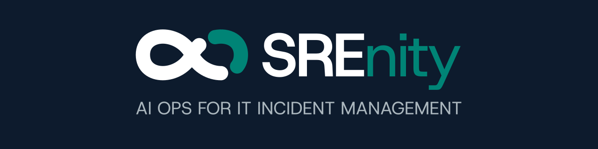

<!-- Keep content in sync with README.md; banner paths differ by directory. -->

  

<h1 align="center">SREnity</h1>

<strong>AI Context Layer for Incidents</strong>

  <a href="https://srenity.tech">Website</a> ·
  <a href="https://srenity.tech/#demo">Explore the demo</a> ·
  <a href="https://srenity.tech/#early-access">Get early access</a> ·
  <a href="mailto:contact@srenity.tech">Contact us</a>

---

An incident's story is scattered across tickets, work notes, diagnostics and monitoring data. The people resolving it also have to piece that story together for everyone waiting on an update.

We're building **SREnity** to bring that context into one place and turn it into clear, evidence-linked drafts: what happened, who is affected, what the evidence supports and what comes next.

Built for **SRE teams, IT operations, network operations centres and managed service providers** who keep services running and stakeholders informed.

## From incident context to clear communication

| Output | What your team gets |
| --- | --- |
| **Incident summary** | A shared account of the incident, its impact and the response, linked to the supporting evidence. |
| **Cited timeline** | A sequence of events traced back to the ticket, work note, alarm or metric behind each one. |
| **Post-incident review (PIR)** | Root-cause findings, lessons learned and follow-up actions with owners. |
| **Stakeholder email drafts** | Plain-language updates for customers and managers, technical detail for engineers, and concise briefings for leadership. |

## Connect → Investigate → Communicate

1. **Connect.** Bring in context through scoped, read-only connections to ITSM, testing and monitoring tools.
2. **Investigate.** Link tickets, responder notes, diagnostics and network data into a coherent account. Surface missing evidence and conflicting records.
3. **Communicate.** Review and edit the summary, timeline, PIR and audience-specific emails, then send from your own tools.

## Evidence first. People in control.

The principles we're building around:

- **Traceable facts.** Claims carry their source passages, with names, numbers, units and timestamps checked against the evidence.
- **Visible uncertainty.** Conflicts stay visible. Root causes are labelled as responder-stated, inferred or unknown.
- **Read-only access.** Connections are scoped to approved endpoints. Engineers retain control of infrastructure, tickets and outgoing communications.
- **Private incident data.** Customer isolation, redaction before model processing and configurable retention are part of the design. Incident data is never used to train or fine-tune models.

Read more about our approach to [evidence and trust](https://srenity.tech/#trust).

## Help shape SREnity

**Coming soon · Early access open.** We're in private build with network operations and MSP teams. The [website demo](https://srenity.tech/#demo) uses simulated incidents to show the intended workflow.

Early sign-ups get a founding-team discount on their first year, a priority pilot slot using their own incidents, and a say in which integrations we build next.

**[Join the early-access list →](https://srenity.tech/#early-access)**

Tell us about your stack and the incident updates that take the most time: [contact@srenity.tech](mailto:contact@srenity.tech).
